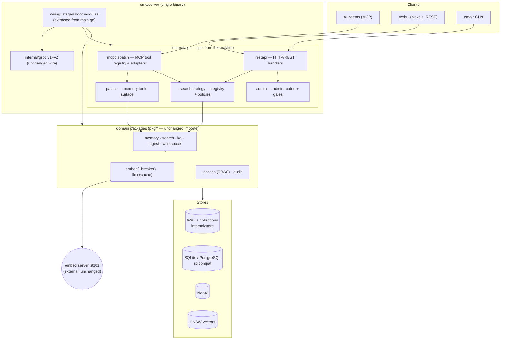
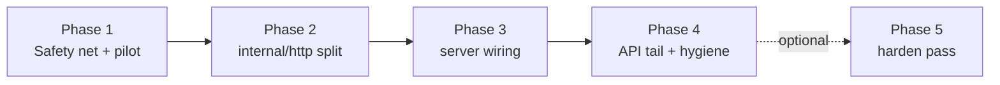

# MODERNIZATION BRIEF — `levara`

Generated 2026-10-16 by `code-modernization` `modernize-brief`.
Inputs (timestamps): ASSESSMENT.md, topology.json + 4 `.mmd`, ARCHITECTURE.mmd
(2026-10-15); PREFLIGHT.md (final answers 2026-10-16); BUSINESS_RULES.md
(cards 2026-10-15, values verified + SME decisions 2026-10-16).
No prior brief exists — first generation.

**Target stack: SAME (Go 1.26.6, toolchain go1.27.2 — no version bump).**
This is an in-place structural refactor, not an uplift to a newer runtime
version; `DELTA_CATALOG.md` is therefore not required (no version deltas
exist). Execution path per phase: refactor-in-place under
`/modernize-uplift`-style gates (characterization + contract equivalence),
executed directly by the main agent in this session.

## 1. Objective

Levara's Go core (982 files, 255.0 KSLOC, COCOMO-II index ≈ 1,305) works,
is well-tested (61 green packages, ~3.3k tests, full suite 373s) and runs
two production instances — but its two structural hubs concentrate all
change cost: `internal/http` (111 files / 40.0k LOC god-package mixing MCP
dispatch, REST, admin, palace API and search strategy, carrying the
hottest methods and nearly all dead code) and `cmd/server/main.go`
(betweenness 133 — every subsystem wired by hand in one function). This
refactor splits those hubs along the domain seams the topology map
confirmed, removes verified-dead API surface first, and locks behavior
behind the P0 rule contract — with **zero intended behavior change** on
MCP/REST/gRPC surfaces and **zero production deploys** (owner-enforced:
tests run only in an isolated environment on a dedicated branch; Mac/Pi
prod instances are not touched in this pass).

## 2. Target Architecture

End state is the same single-binary system with restructured packaging —
no new services, no data-store changes, no wire-format changes.



| Legacy component | Target component(s) | Notes |
|---|---|---|
| `internal/http` (111 files, 40k LOC) | `internal/api/{mcpdispatch, palace, restapi, admin, searchstrategy}` (+ thin compatibility façade during transition) | Exact sub-package layout finalized in Phase 2 pilot; MCP tool names, REST routes, error shapes unchanged |
| `cmd/server/main.go` (god-main) | staged boot/wiring modules under `cmd/server/` (config → stores → pipelines → transports), `runreg`-anchored | Boot order and log output preserved |
| `internal/http/mcp*.go` dead candidates | deleted (after dispatch-table cross-check) | Verified via gortex + `ToolDescriptors` |
| `internal/grpc/service.go` v1 dead methods | removed or retirement note | Wire contract for live methods unchanged |
| `pkg/*`, `internal/{store,cluster,metrics,...}` | unchanged (import paths stable) | Their tests are the safety net |

## 3. Phased Sequence

Ordering: build-graph **leaf-first** (safety net → dead surface → god-package
split leaf-inward → wiring → tail). Uplift overrides applied at planning
time: (1) test harness already runs on the (unchanged) target — suite
green 2026-10-16, no Phase-0 harness work needed; (2) no coordinated
dependency cuts (no major bumps in scope); (3) shared nodes with consumers
outside scope = the MCP/REST/gRPC wire surfaces — decision recorded:
**contract freeze** (behavior + shapes preserved; equivalence-gated), scope
NOT expanded to consumers.

**Owner-enforced working discipline (hard invariant, all phases):** every
test run happens in an isolated environment on a **dedicated branch**
(`refactor/levara-core-1`), never on `v3`/`main` working state, never
against prod data or prod instances. Merge only through the repo's
fail=0 gate pattern.

**Phase 1 is a pilot, and this brief is a hypothesis.** Phase 1's
extraction slice is the representative unit for the Phase-2 recipe. What
the pilot surfaces (a hidden coupling, a prerequisite nobody wrote down, a
wrong seam) is *expected* to revise this brief; regenerating the brief
after the pilot is the normal path, not a correction.



### Phase 1 — Safety net & pilot (M; ~12% of index)

**Scope:**
- (a) **B3 invariant tests** (owner-mandated first): API-key permissions
  only narrow, never widen, role access — on MCP, REST and gRPC surfaces
  (RED first where untested, then GREEN).
- (b) **Verified dead-code sweep**: `internal/store/heap.go` dead clone
  pair; `internal/grpc/service.go:160,164` (v1 ListCollections/HasCollection);
  `internal/http/mcp*.go` candidates — each cross-checked against the MCP
  dispatch table (`pkg/mcp` ToolDescriptors) and generated contracts before
  deletion; `benchmark/memory_eval` py helper noted only (out of Go scope).
- (c) **Pilot extraction**: move one cohesive slice of `internal/http` into
  its target package — default `memories.go` + `mcp_palace.go` (memory
  palace surface) behind the unchanged MCP dispatch — through the FULL
  recipe: baseline → move → suite → contracts → race.

**Entry criteria (checkable):**
- [ ] `analysis/levara/BASELINE.md` exists: commit SHA of green full suite,
  hashes of `docs/contract*.json`, list of P0-rule-covering test IDs
  (from §5 mapping), measured suite duration.
- [ ] Dedicated branch `refactor/levara-core-1` created from current `v3`
  HEAD; work happens there only.
- [ ] Dead-code list from ASSESSMENT §Debt-3 re-verified against
  `ToolDescriptors` output (script or gortex check recorded in BASELINE.md).

**Exit criteria:**
- [ ] B3 invariant tests exist and pass on all three surfaces.
- [ ] Each deleted symbol: grep-clean, suite green, contracts byte-identical.
- [ ] Pilot slice moved; `go test ./...` green on the branch; `go test
  -race` green for touched packages; MCP contract files regenerated and
  drift-free; no changes outside `internal/http` (+ new package) and test
  files.
- [ ] Pilot retrospective written into `analysis/levara/PILOT_NOTES.md`
  (what the recipe missed) — input for brief regeneration.

**Risks:** (1) dispatch-reachable "dead" methods deleted by mistake →
mitigation: ToolDescriptors cross-check + contract drift gate + per-symbol
`get_callers` verification; (2) pilot slice entangled with unrelated
handlers → mitigation: slice choice re-examined, brief revised (expected).

### Phase 2 — `internal/http` decomposition (XL; ~45% of index)

**Scope:** split the god-package by bounded context into
`internal/api/*` per the §2 mapping, leaf-inward: embed/search adapters →
searchstrategy → palace → restapi/admin → mcpdispatch last (the dispatcher
is the root; it moves when its leaves are settled). Each sub-move reuses
the Phase-1 pilot recipe unchanged.

**Entry criteria:** Phase 1 exit criteria all met; pilot recipe
re-confirmed or brief regenerated.

**Exit criteria:** `internal/http` reduced to a thin façade (or gone, if
imports allow a clean cut); full suite + race green; contracts drift-free;
`pkg/mcp` tool names/arg shapes untouched; REST route inventory unchanged
(route list diff = empty); REVIEW of each sub-move recorded.

**Risks:** (1) hidden coupling between palace and REST handlers (shared
Deps struct) → mitigation: façade keeps compilation green while deps are
threaded explicitly, one sub-move at a time; (2) 315s http-suite cost
slows iteration → mitigation: per-step targeted packages, full suite at
sub-move boundaries only.

### Phase 3 — Server wiring extraction (M; ~15% of index)

**Scope:** decompose `cmd/server/main.go` (fan-out 381, betweenness 133)
into staged boot modules (config → stores → pipelines → transports),
anchored on the existing `pkg/runreg`.

**Entry criteria:** Phase 2 exit met.

**Exit criteria:** `main()` reduced to orchestration of named stages; boot
order provably unchanged (startup log diff = empty); suite + race green;
cold-start path exercised once in the isolated env.

**Risks:** (1) initialization order dependencies invisible in source →
mitigation: startup-sequence log diff as a hard gate; (2) prod plist
invokes the binary with flags — mitigation: flag surface unchanged, no
deploy (owner gate).

### Phase 4 — API tail & hygiene (S; ~5% of index)

**Scope:** gRPC v1 duality decision (remove verified-dead v1 methods or
document retirement — wire change requires owner sign-off either way);
`math-rand-for-crypto` (6 spots), `xml-decoder-no-strict` (2 spots);
exclude `webui/node_modules/**` from `./...` test runs.

**Entry criteria:** Phase 3 exit met; owner decision on gRPC v1 removal
(checkbox in §7).

**Exit criteria:** chosen path executed; suite + race green; hygiene spots
fixed with tests; `go test ./...` no longer descends into node_modules.

**Risks:** (1) v1 method removal breaks an unknown external caller →
mitigation: keep removal behind the §7 explicit decision, default is
"document, don't remove".

### Phase 5 — Harden pass (S; optional follow-on; ~8% of index)

**Scope:** run `/modernize-harden` over the Go core: 143 path-join findings
(CWE-22), 4 SSRF candidates in fetch (verify loopback/private rejection),
26 env fallbacks (CWE-1188). Output: SECRETS-quarantined report + patch the
owner applies manually.

**Entry criteria:** Phases 1–4 merged; owner opts in.

**Exit criteria:** harden report delivered; owner applies/declines each
patch item.

**Risks:** path-hardening changes accepted file layouts → mitigation:
hardening is a separate, individually-reviewed pass, not folded into moves.

### Explicitly OUT of this pass (owner decisions 2026-10-16)

- Tags matching unification (MCP exact vs REST case-insensitive) — separate
  mini-project after verify.
- `supersedes_memory_id` → `superseded_by` fix — separate post-refactor step.
- webui hook-clone cleanup, pytest fixture dedup (non-Go scope).
- Go directive bump (1.26.6 → 1.27) — see §7 checkbox.
- Any production deployment (Mac/Pi) — requires separate explicit owner go.

## 4. Business Walkthroughs

From `topology.json` flows — note this is a refactor: flows keep their
behavior; the right-hand column says which phase touches the modules
implementing them.

| Persona & flow | What happens (business language) | Implements today | Phase touching it |
|---|---|---|---|
| AI agent: saves and later recalls a memory | Agent stores a durable decision; in a later session it comes back ranked, with history hidden unless asked | `pkg/mcp` tools, `internal/http` dispatch, `pkg/memoryhall`, `internal/store`, `pkg/embed`, `pkg/vectorstore` | 1 (pilot slice + dead sweep), 2 (dispatch split) — behavior frozen by RULE-001/015/016/021/022/027 |
| Engineer: ingests a repo, explores knowledge graph | Point Levara at git; it extracts entities/edges with time validity; query who-did-what as-of a date | `pkg/ingest`, `pkg/git`, `pkg/chunker`, `pkg/llm`, `pkg/orchestrator`, `pkg/graphdb`, `pkg/temporal` | None (pkg/* untouched) — RULE-017/018 remain the contract |
| Operator: backs up and restores production | Verified snapshot of collections with isolated restore check | `cmd/backup`, `pkg/backup`, `internal/store`, `pkg/storage` | 1 (bounds rules verified), no structural change — RULE-005/006 |

## 5. Behavior Contract (P0 rules — must be proven equivalent before any phase ships)

All 8 P0 rules are Confidence: High (RULE-023 Medium-by-reading but
confirmed as contract by owner decision B4, 2026-10-16) — no SME blockers.

| Rule | One-line contract | Equivalence proof vehicle |
|---|---|---|
| RULE-001 | Hall vocabulary closed; exact match; empty=unset | existing hall validation tests (ledger I06) |
| RULE-015 | Same-key save archives retired memory in-transaction | archive/retire tests + new pilot characterization |
| RULE-016 | Superseded hidden by default; includeSuperseded opts in (error asymmetry preserved per B2) | recall tests; explicit both-branch tests added Phase 1 |
| RULE-017 | Exclusive-rel edges auto-close prior open edge (valid_until/superseded_by) | `pkg/orchestrator` upsert tests |
| RULE-018 | Graph upserts deduped, single transaction, dataset-scoped | same |
| RULE-021 | Recall never fails on embed errors — vector→LIKE cascade | embed-degradation tests (breaker suite) |
| RULE-023 | Filters pre-rerank; tags ANY/OR; explicit-filter zero-match = empty; MCP exact vs REST insensitive (dual contract per B4) | integration506 (ledger T10) + contract drift gate |
| RULE-027 | LIKE fallback owner-scoped always | owner-isolation tests (ledger I02/I06 family) |

Plus Phase-1-added invariant (owner B3): **API-key narrows, never widens,
on MCP+REST+gRPC** — becomes part of this contract once its tests land.

## 6. Validation Strategy

- **Characterization:** the existing suite IS the characterization net
  (61 packages, ~3.3k tests incl. dual-SQL RED/GREEN suites from the
  decomposition program). Full run = 373s → affordable at every sub-move
  boundary; targeted packages during iteration. Known flake
  `TestLouvain_1K_Performance` re-run in isolation before declaring red.
- **Contract tests:** generated MCP contracts (`docs/contract*.json`)
  byte-drift gate after every phase touching `internal/http`; REST route
  inventory diff; gRPC wire unchanged.
- **Race:** `go test -race` for touched packages at every boundary; full
  `-race` before merge (repo `full-race.yml` precedent).
- **Dual-execution diff:** not applicable (no runtime version change);
  equivalence is proven by the two mechanisms above.
- **Manual UAT:** one cold-start smoke in the isolated env after Phase 3
  (boot-order log diff). No prod canary in this pass (owner gate).
- **Environment:** isolated env + dedicated branch, per owner rule;
  `BASELINE.md` records the reference point each phase must return to.

## 7. Open Questions — RESOLVED 2026-10-16 (owner chat directive "Продолжай")

- [x] gRPC v1 dead methods: **document retirement only** (owner: "1 -
      документировать"). Wire surface unchanged in this pass.
- [x] Bump `go` directive 1.26.6 → 1.27.2 in Phase 4: **yes** (owner:
      "2 поднять"). Toolchain go1.27.2 already builds and tests green
      (verified 2026-10-15), so this is a directive-only change with the
      suite as its gate.
- [x] Phase 5 (harden): **included in this approval** (owner questioned
      deferral; "Продолжай"). Deferral was proposed only because harden's
      patches are owner-applied anyway; inclusion is equally safe since
      the patch-application step remains an explicit owner gate inside
      Phase 5.

## 8. Approval Block

```
Approved by: Alexey Stekov (chat directive 2026-10-16: "1 - документировать
2 поднять 3 ... Продолжай")   Date: 2026-10-16
Approval covers: Full plan (Phases 1-5)
```

Approvers steer execution by editing this file — entry criteria are read
as binding gates by the executing phase.
